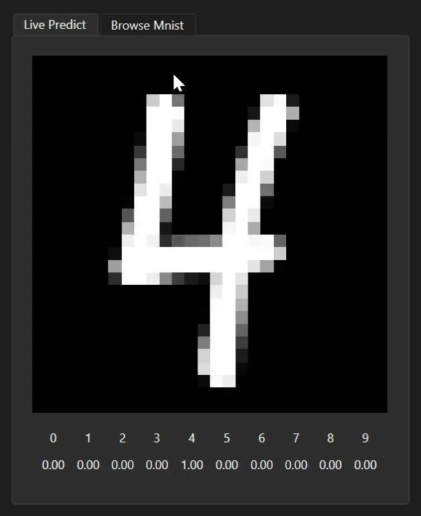

# Multilayer Perceptron in C++ and CUDA

A small neural network for recognizing handwritten digits (MNIST), written from scratch in C++. I implemented it three times: with Eigen, with OpenBLAS plus my own AVX2 code, and with cuBLAS plus my own CUDA kernels. The CUDA version also builds as a DLL with a C API, and a Qt 6 app uses it to classify digits while you draw them.

<a href="https://www.youtube.com/shorts/9dwyB3GEBBo">
  
</a>

Demo video: https://www.youtube.com/shorts/9dwyB3GEBBo

I started this as my project for the ML@Chaos course (Chaos Camp Vol. 2). The [presentation slides](https://www.canva.com/design/DAGe6p4vc_I/1G5lmcWNNLghCjH7JtL0qQ/edit?utm_content=DAGe6p4vc_I&utm_campaign=designshare&utm_medium=link2&utm_source=sharebutton) cover the Eigen version. I added the OpenBLAS and CUDA versions and the GUI after the course.

## Overview

The network has 784 inputs (one per pixel of a 28x28 image), one hidden layer of 128 ReLU units and 10 softmax outputs. It is trained with cross-entropy loss and mini-batch SGD with a learning rate of 0.01. Everything, including backpropagation, is written by hand; no ML framework is used.

The CUDA version reaches about 96.5% accuracy on the MNIST test set after 100 epochs, and one epoch takes about 0.09 s on a laptop RTX 4070.

| Version | Folder | Matrix math | Other work |
|---|---|---|---|
| Eigen | [eigenMlp/](eigenMlp) | Eigen | `.noalias()`, preallocated buffers, 32 threads |
| OpenBLAS | [openBlasMlp/](openBlasMlp) | OpenBLAS `sgemm` | AVX2 code with data stored as `__m256`, vectorized `exp` from SLEEF |
| CUDA | [cuBlasMlp/](cuBlasMlp) | cuBLAS and cuBLASLt | CUDA kernels for softmax, ReLU, one-hot, bias gradients (CUB block reduce) and the loss gradient; C API in [cublas_mlp_api.h](cuBlasMlp/cublas_mlp_api.h) |
| GUI | [qt-frontend/](qt-frontend) | uses the CUDA DLL | draw a digit and see the prediction live, or browse the MNIST images |

## Benchmarks

Average time per training epoch over 10 epochs. All versions are built for AVX2 with `/fp:fast`.

| Version | Batch size | Ryzen 9 5950X, RTX 3070 Ti | Core Ultra 7 165H, RTX 4070 Laptop |
|---|---|---|---|
| Eigen | 64 | 0.6 s | 170 s |
| OpenBLAS + AVX2 | 64 | 0.55 s | 0.67 s |
| Eigen | 128 | 9.6 s | 208 s |
| OpenBLAS + AVX2 | 128 | 0.33 s | 0.4 s |
| CUDA | 128 | 0.095 s | 0.090 s |

Eigen gets very slow once a matrix has more than 9,984 elements, so it falls behind with larger batches, and it is much slower on the Intel laptop than on the Ryzen desktop. The OpenBLAS version gets faster with larger batches, as expected.

### Speeding up the CUDA version

Training time for 110 epochs with batch size 128, from my notes in [docs/benchCublas.txt](docs/benchCublas.txt):

| Change | Training time |
|---|---|
| First working version | 43.4 s |
| Move semantics instead of copies | 30.9 s |
| Preallocated vector of ones | 25.6 s |
| Fixed a reallocation bug in `dupRows` | 14.9 s |
| One kernel for "softmax output minus one-hot labels" | 12.2 s |
| Bias gradients in a custom kernel with CUB block reduce | about 11.5 s |
| Final | 10.2 s (96.6% accuracy) |

A CPU profile I took during this work showed the host thread spending most of its time in the CUDA driver, launching small kernels and waiting for them, and only about 9% in my own code. Doing more work per kernel is what helped most. The profile is summarized in [docs/profile-2025-03-02-cublas.md](docs/profile-2025-03-02-cublas.md).

## Tests

The CUDA and OpenBLAS versions run unit tests every time they start. Each test runs an operation for every combination of matrix sizes from 1 to 5 and compares the result with the same calculation in Eigen. The tests cover matrix multiplication with all four transpose combinations, ReLU, softmax, one-hot encoding, row broadcasting and the positive mask. The CUDA version also tests column sums and its GPU memory wrapper, and prints `Passed all unit tests` at the end.

A failed check prints `Test failed`. In Debug builds it also stops the program with an assert; Release builds compile the assert out.

## Building

You need:

- Windows and Visual Studio 2022 (MSVC v143, C++20)
- a CPU with AVX2
- CUDA Toolkit 12 and an NVIDIA GPU, for the CUDA version and the GUI
- Qt 6 and CMake 3.16 or newer, for the GUI

Eigen, OpenBLAS and SLEEF are included in the repository ([include/](include), [lib/](lib), [dll/](dll)). I last built it with MSVC 14.44, CUDA 12.8 and Qt 6.9.

First, unpack the MNIST data into `assets.ignored/`, where all programs look for it:

```powershell
Expand-Archive MNIST_ORG.zip -DestinationPath assets.ignored
```

Then open `cppMlp.sln`, select Release and x64, and build. You can run any of the three projects from Visual Studio; their working directory is already set to the repository root. From a Developer Command Prompt:

```powershell
msbuild cppMlp.sln /p:Configuration=Release /p:Platform=x64
.\x64\Release\cuBlasMlp.exe
```

The other two programs are `x64\Release\openBlasMlp.exe` and `x64\Release\eigenMlp.exe`. Run them from the repository root too.

### GUI

[qt-frontend/](qt-frontend) is a CMake project, so you can open it in Qt Creator or build it with CMake. It links a prebuilt copy of the CUDA DLL from [qt-frontend/dll/](qt-frontend/dll). To use your own build instead, build `cuBlasMlp` in the dllRelease configuration and copy `x64\dllRelease\cuBlasMlp.dll` and `cuBlasMlp.lib` into that folder.

Run the app with `qt-frontend/` as the working directory, because it loads MNIST from `../assets.ignored`. It trains the network when it starts, which takes about 10 seconds on a recent GPU. In the drawing tab, Space clears the canvas and Ctrl+S saves the 28x28 input image to `assets.ignored/tabletOut.png`.

## License

[MIT](LICENSE)
